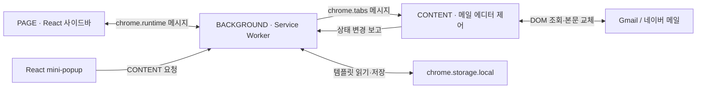
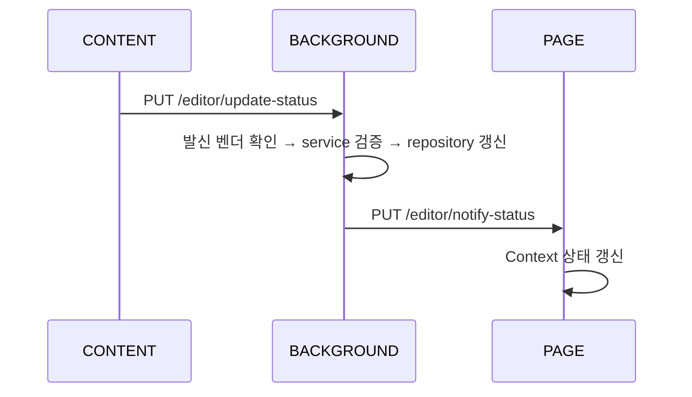

# Snip Text 동작 구조

이 문서는 현재 저장소의 구현을 기준으로 확장 프로그램의 실행 영역, 데이터 관리, 메시지 통신, 템플릿 삽입과 톤 교정 흐름을 설명합니다. `PAGE`, `BACKGROUND`, `CONTENT`는 Chrome 확장 프로그램 내부의 실행 영역을 구분하는 이름입니다.

## 1. 전체 구조

메일 페이지의 DOM에 접근할 수 있는 content script와 사이드바 화면은 서로 다른 환경에서 실행됩니다. background가 두 영역의 요청을 중계하고, 에디터 상태와 템플릿 데이터를 관리합니다.



mini-popup은 메일 페이지에 content script가 마운트하는 React UI입니다. 별도의 확장 프로그램 페이지로 실행되는 사이드바와 구분됩니다. background는 HTTP 서버가 아니라 Chrome 메시지를 처리하는 Service Worker입니다. `/template/list` 같은 경로도 실제 네트워크 주소가 아닌 내부 라우팅 식별자입니다.

| 영역 | 주요 진입점 | 담당 역할 |
| --- | --- | --- |
| background | `src/background/service-worker.ts` | 요청 분기, 발신자 검증, 서비스 호출, 데이터 관리, 삽입 중계 |
| content | `src/content/gmail.ts`, `src/content/naver.ts` | 에디터 탐색, 상태 감지, mini-popup 시작, 본문 DOM 변경 |
| sidebar | `packages/sidebar/src/main.tsx`, `App.tsx` | 템플릿 검색·복사·삽입, 변수 입력, 톤 교정 화면 |
| mini-popup | `packages/mini-popup/src/index.tsx` | `\` 명령 감지, 목록·변수 폼·문체 선택 표시 |

## 2. 초기 실행

### 2.1 확장 프로그램 등록

`public/manifest.json`은 Manifest V3 설정입니다.

- background는 `src/background/service-worker.js`로 실행됩니다.
- Gmail은 `https://mail.google.com/*`에서 `gmail.js`를 실행합니다.
- 네이버 메일은 `https://mail.naver.com/*`에서 `naver.js`를 실행합니다. `all_frames`와 `match_origin_as_fallback`을 사용해 하위 프레임도 실행 대상으로 등록합니다.
- 두 content script는 `document_idle`에 실행됩니다.
- 사이드바의 진입 경로는 `src/page/index.html`입니다.
- 확장 프로그램 아이콘을 클릭하면 background가 클릭한 탭의 사이드바를 엽니다.

manifest의 프레임 주입 조건과 background의 메시지 발신자 허용 조건은 별개입니다. 스크립트가 실행되더라도 발신자 검증을 통과해야 요청이 처리됩니다.

### 2.2 Gmail

`gmail.ts`는 렌더링 이후 벤더 설정의 에디터 선택자로 `COMBINED` observer를 시작합니다. observer가 만들어지면 mini-popup을 시작하고 background의 삽입 요청을 받을 content 라우터를 등록합니다.

### 2.3 네이버 메일

`naver.ts`는 최상위 문서와 하위 프레임을 나누어 처리합니다.

1. 최상위 문서에서는 초기 URL이 작성 경로일 때 URL observer를 시작합니다.
2. URL observer는 약 100ms마다 주소 변화를 확인하고 작성 경로 여부를 `isEditable`로 보고합니다.
3. 실제 에디터 observer는 에디터 선택자가 존재하는 하위 프레임에서 시작합니다.
4. 해당 프레임에서 mini-popup과 content 삽입 라우터를 등록합니다.

작성 경로는 `/v2/new` 또는 그 하위 경로입니다. 최상위 문서의 URL 상태와 하위 프레임의 DOM 상태는 같은 벤더의 에디터 상태로 보고됩니다.

## 3. 메시지 통신과 권한

### 3.1 요청·응답 형식

공통 계약은 `src/core/message-types.ts`에 있습니다. workspace 패키지는 자체 메시지 타입과 래퍼도 가지고 있습니다.

```ts
const request = {
  src: "PAGE",
  dst: "BACKGROUND",
  method: "GET",
  path: "/template/list",
  data: {},
};

const response = {
  statusCode: 200,
  data: { templates: [] },
};
```

`src`와 `dst`는 실행 영역, `method`와 `path`는 동작, `data`는 입력값을 나타냅니다. `src` 문자열만으로 권한을 인정하지 않고 Chrome이 제공한 `sender`도 검사합니다.

`src/common/message-bus.ts`의 주요 역할은 다음과 같습니다.

- `sendMessage`: `chrome.runtime.sendMessage`로 확장 프로그램 내부 요청을 보냅니다.
- `sendToActiveTab`: 현재 창의 활성 탭을 찾고 `chrome.tabs.sendMessage`로 content에 요청합니다.
- `listenMessage`: 비동기 처리가 끝난 뒤 `sendResponse`로 응답합니다. 처리 중 예외는 일반적인 500 응답으로 변환합니다.

발신자 불일치나 담당하지 않는 요청은 응답 없이 반환할 수 있습니다. 호출부는 응답이 없거나 200이 아닌 경우도 처리해야 합니다.

### 3.2 background 라우팅

Service Worker는 `dst === "BACKGROUND"`인 요청을 경로 접두사로 분기합니다.

| 접두사 | 라우터 | 역할 |
| --- | --- | --- |
| `/auth/` | `background/auth/router.ts` | 토큰 CRUD |
| `/template/` | `background/template/router.ts` | 템플릿 조회·교체 |
| `/editor/` | `background/editor/router/router.ts` | 상태 조회·갱신·본문 삽입 |
| `/ai/` | `background/ai/router.ts` | 톤 교정 요청 |

어느 접두사에도 해당하지 않으면 404를 반환합니다. 각 라우터 안에서 지원하지 않는 경로·메서드는 응답 없이 끝날 수도 있습니다.

### 3.3 발신자 검사

`src/background/common/message-sender.ts`가 검증을 담당합니다.

PAGE 요청은 `src === "PAGE"`, 현재 확장 프로그램 ID, `sender.tab` 부재, 정확한 `chrome.runtime.getURL("src/page/index.html")` 주소가 모두 일치해야 합니다.

CONTENT 요청은 현재 확장 프로그램 ID, 유효한 탭 ID와 프레임 ID, 등록된 HTTPS 메일 호스트를 검사합니다. `sender.origin`이 있으면 URL의 origin과 같아야 합니다. 예외적으로 `frameId > 0`인 `about:blank` 프레임은 허용된 메일 origin을 상속한 경우 통과합니다. 현재 구현은 `about:srcdoc`, `blob:`, `data:`, `filesystem:`을 허용하지 않습니다.

| 요청 | PAGE | CONTENT |
| --- | --- | --- |
| 템플릿 목록 | 허용 | 유효한 인증 토큰이 있으면 허용 |
| 템플릿 새로고침·전체 교체 | 허용 | 불허 |
| 인증 상태 조회 | 허용 | 허용 |
| 인증 토큰 조회·등록·삭제, 로그아웃 | 허용 | 불허 |
| 에디터 본문 조회·삽입 | 허용 | 허용 |
| 에디터 전체 상태 조회 | 허용 | 불허 |
| 에디터 상태 보고 | 불허 | 허용 |
| 톤 교정 | 허용 | 허용 |

## 4. 에디터 상태 관리

### 4.1 데이터 구조와 저장 범위

```ts
interface EditorStatus {
  isEditable: boolean;
  text: string;
  prevTexts: string[];
  vendorName: "GOOGLE" | "NAVER";
}
```

`background/editor/repository.ts`는 벤더별 상태를 `chrome.storage.session`의 `snip.editors`에 AES-256-GCM 암호문으로 보관합니다. 초기값은 편집 불가, 빈 본문, 빈 이전 본문 목록입니다.

이 상태는 탭별·프레임별 저장이 아닙니다. 같은 벤더의 여러 탭이나 작성 창이 상태를 보고하면 하나의 벤더 상태를 공유합니다. 같은 브라우저 세션에서는 서비스 워커가 재시작해도 상태를 읽을 수 있습니다.

### 4.2 변경 감지

현재 두 벤더가 사용하는 `EditorCombinedObserver`는 다음 입력을 함께 감지합니다.

- `focusin`: 사용자가 선택한 에디터를 확인합니다.
- `input`: 본문 입력 변화를 확인합니다.
- `MutationObserver`: 에디터 생성·삭제, 텍스트와 속성 변경을 확인합니다.

포커스된 요소 또는 그 조상에서 에디터를 우선 찾고, 없으면 화면에 보이는 첫 에디터를 선택합니다. 에디터나 본문이 달라졌을 때 callback을 예약하며, 같은 이벤트 루프의 여러 변경은 `queueMicrotask`로 합칩니다.

대체 구현으로 DOM 변경만 감지하는 `EditorMutationObserver`와 250ms마다 확인하는 `EditorPollingObserver`가 있습니다. `COMBINED` 자체는 폴링을 사용하지 않습니다.

### 4.3 상태 전달



content는 `{ vendorName, status: { isEditable, text } }`를 보냅니다. background는 실제 발신 URL의 벤더와 요청 벤더가 같은지 확인합니다. service는 필드별 타입을 확인하고 알 수 없는 필드나 서로 다른 `vendorName`을 거부합니다.

사이드바의 `useMessageListener`는 알림 리스너를 먼저 등록한 뒤 활성 탭의 벤더에 대해 `GET /editor/status`를 요청합니다. 초기 조회가 늦게 도착해도 이미 받은 실시간 알림을 덮어쓰지 않습니다. 상태는 벤더별 `statuses`와 가장 최근 수신 상태인 `latestStatus`로 관리하고, 수신 시각과 갱신 횟수를 함께 기록합니다. 언마운트 시 리스너를 제거합니다.

## 5. 템플릿 데이터 관리

### 5.1 스키마와 목록 조회

```ts
interface Template {
  templateId: number;
  title: string;
  shortcut: string;
  content: string;
  variables: string[];
  lastUsedAt: string;
  createdAt: string;
  editedAt: string;
}
```

`GET /template/list`는 `200 { templates }`를 반환합니다. repository는 `chrome.storage.local`의 `snip.templates`를 읽고, 저장값이 없으면 빈 배열을 반환합니다. 공통 스토리지 모듈은 저장 시 고정 키로 AES-256-GCM을 적용합니다.

과거 데이터의 `id`, `name`, `command`, `text`는 현재 필드로 변환합니다. 유효하지 않은 ID에는 사용 중인 ID를 피해서 양의 정수를 부여하고, 변수 목록이 없으면 본문에서 추출합니다. 날짜 정보가 없으면 `1970-01-01T00:00:00.000Z`를 기준으로 보완합니다. 이 변환은 조회 결과를 만드는 과정이며 조회만으로 원본을 다시 저장하지 않습니다.

목록 API는 repository 순서를 유지합니다. 사이드바는 응답 순서대로 표시하고, 미니 팝업은 검색어가 없는 목록을 `lastUsedAt` 기준으로 정렬합니다. 사용 시각을 갱신하는 메시지 경로는 구현되어 있지 않습니다.

PAGE 또는 허용된 대시보드의 `POST /template/refresh`는 설정된 API에서 받아 검증한 목록으로 로컬 캐시 전체를 교체합니다. 조회·검증에 실패하면 기존 목록을 유지합니다. 운영 API 요청에는 유효한 인증 토큰이 필요합니다.

### 5.2 템플릿 전체 교체

PAGE의 `PUT /template/replace`는 위 스키마의 모든 필드를 받아 기존 템플릿 하나를 전체 교체합니다. 일부 필드만 병합하는 PATCH 동작이 아닙니다.

service의 검증 조건은 다음과 같습니다.

- ID는 안전한 양의 정수여야 합니다.
- 정의되지 않은 필드는 허용하지 않습니다.
- 이름·단축어·본문은 공백만으로 구성할 수 없습니다.
- 이름과 단축어는 양끝 공백을 제거하고, 본문은 원문을 유지합니다.
- 단축어는 `/`로 시작하며 뒤에 공백이나 추가 `/`가 없어야 합니다.
- 변수는 양끝 공백이 없는 중복 없는 문자열 배열이어야 하고 본문의 변수 집합과 같아야 합니다.
- 날짜 세 필드는 시간대가 포함된 ISO 8601 형식이며 파싱 가능한 값이어야 합니다.
- 다른 템플릿과 단축어가 중복되면 거부합니다.

운영 API가 설정되어 있으면 서버에 제목·단축어·본문을 전송하고, 검증된 서버 응답을 로컬 캐시에 반영합니다. 그 외에는 로컬 레코드를 교체합니다. service는 서버 목록 동기화와 수정 요청을 직렬화하고, repository는 저장 연산을 직렬화합니다. [요청과 응답](api.md#put-templatereplace)

## 6. 본문 삽입

### 6.1 요청 대상을 선택하는 방법

두 UI는 모두 `PUT /editor/insert-text`와 `{ text }`를 사용하지만 background의 전달 대상이 다릅니다.

| 요청 시작점 | 전달 대상 |
| --- | --- |
| 사이드바 PAGE | 현재 창의 활성 탭 |
| mini-popup CONTENT | 요청을 보낸 탭과 동일한 프레임 |

CONTENT 요청은 `sender.tab.id`와 `sender.frameId`로 전달 대상을 지정합니다. PAGE 요청은 `sendToActiveTab`을 사용하며 프레임 ID를 지정하지 않습니다.

### 6.2 실제 DOM 변경

1. background는 비어 있지 않은 문자열인지 확인합니다.
2. `BACKGROUND → CONTENT` 삽입 메시지를 보냅니다.
3. content 라우터는 문자열을 정규화하고 미치환 `{{...}}`가 남아 있으면 400으로 거부합니다.
4. observer가 추적하는 에디터를 가져옵니다.
5. `insertTextToEditor`가 `<br>`와 문단 경계를 개행으로 읽어 이전 본문으로 보관하고 에디터 내용을 비웁니다.
6. 새 본문을 텍스트 노드와 `<br>`로 구성하고 커서를 끝에 둡니다.
7. content가 `prevText`, `text`, `isInserted`, `vendorName`을 반환합니다.
8. background는 반환된 본문과 이전 본문을 저장한 뒤 PAGE에 상태를 알립니다.

현재 삽입은 **에디터 본문 전체 교체**입니다. mini-popup이 `\검색어`의 Range를 보관하는 목적은 트리거와 작성 창의 유효성 검사입니다. 실제 삽입 함수는 해당 Range만 치환하지 않습니다.

이전 본문은 비어 있지 않을 때 `prevTexts` 앞에 추가합니다. 일반적인 삽입 이력 추가 경로는 최대 두 항목을 유지합니다. 이력 저장과 별개로 사용자용 되돌리기 API나 UI는 현재 연결되어 있지 않습니다.

### 6.3 텍스트 정규화와 공백 처리

`src/content/utils/editor-text.ts`가 공통 처리를 담당합니다.

- `normalizeEditorText`: U+200B를 제거하고 Unicode NFC로 정규화합니다. 다른 공백과 이모지 결합 문자는 유지합니다.
- `encodeEditorText`: CRLF를 LF로 바꾸고 줄 양끝 공백과 연속된 일반 공백을 NBSP로 변환해 HTML 에디터에서 공백이 접히는 것을 줄입니다.

삽입은 `innerHTML` 대신 텍스트 노드를 사용하므로 HTML 형태의 입력도 문자로 삽입합니다. Range 처리가 실패하면 같은 텍스트 노드와 `<br>`로 본문을 교체합니다. 현재 함수는 별도의 `input` 이벤트를 발생시키지 않으므로 메일 서비스의 입력 인식과 실행 취소 동작은 실제 브라우저에서 확인해야 합니다.

## 7. mini-popup

### 7.1 패키지와 상태 분리

`snip-text-mini-popup`은 메일 문서에 호스트와 React root를 생성합니다. `startPopup`은 이를 제거하는 정리 함수를 반환합니다.

| 파일·영역 | 역할 |
| --- | --- |
| `index.tsx` | 호스트·React root 생성, 연결 옵션 선택 |
| `actions.ts` | 템플릿·본문 조회, 삽입, 톤 교정 메시지 연결 |
| `hooks/popup/useMiniPopup.ts` | 화면 상태, 요청 경합, 선택·삽입 흐름 |
| `hooks/popup/usePopupPosition.ts` | 렌더링과 viewport 변경에 따른 위치 갱신 |
| `hooks/editor/` | 외부 편집기 이벤트 구독, Range 보관·검증, 커서 복원 |
| `hooks/keyboard/` | 화면별 키 핸들러 등록, 목록 탐색, React 포커스 관리 |
| `hooks/template/` | 변수 입력·검증과 템플릿 치환 |
| `hooks/popup/usePopupEventIsolation.ts` | 팝업 이벤트 전파 차단 |
| `components/` | 목록, 변수 입력, 문체 메뉴, 로딩 화면 |
| `utils/` | 변수 추출·치환과 팝업 좌표 계산 |

소비자는 조회·삽입 함수를 직접 주입하거나 `vendorName`, `getEditorStatus`를 넘겨 기본 Chrome 메시지 연결을 사용할 수 있습니다. 현재 content 진입점은 후자의 방식을 사용합니다.

### 7.2 트리거와 검색

`useEditorAnchor`는 선택 영역과 커서 앞 텍스트를 읽어 `\검색어`를 찾습니다. 일반 명령은 본문 시작 또는 공백 다음에서 시작합니다. 본문 끝의 단독 역슬래시는 앞 문자가 공백이 아니어도 트리거가 됩니다. `₩`도 접두사로 인식하며 검색어에는 공백과 두 접두사 문자를 사용할 수 없습니다. `\톤`, `\톤교`, `\톤교정` 계열은 별도 명령으로 인식합니다.

트리거를 찾으면 에디터, Range, 트리거 원문을 보관합니다. 삽입 전에 에디터가 문서에 연결되어 있고 Range가 같은 트리거를 가리키는지 확인합니다. 메일 페이지가 DOM을 다시 만들면 재입력을 안내합니다.

일반 검색은 background에서 목록을 가져와 단축어의 첫 접두사 문자를 제외하고, NFC와 소문자로 정규화한 단축어가 검색어로 시작하는 항목을 표시합니다. 톤 교정 접두사를 입력하면 전용 명령을 먼저 표시합니다.

### 7.3 화면 상태와 비동기 처리

화면은 `closed`, `loading`, `error`, `list`, `variables`, `tones`, `login` 상태로 관리합니다. 삽입·교정 중에는 `busy`로 중복 동작을 막습니다.

각 비동기 요청에는 증가하는 `requestId`를 사용합니다. 검색 변경, 팝업 닫기, 언마운트 이후 도착한 과거 응답은 반영하지 않습니다. 한글 조합 시작·종료도 추적해 조합 중 Enter나 방향키가 선택 동작으로 잘못 처리되는 것을 방지합니다.

목록은 ↑↓와 Enter를 처리하며, 문체 선택은 ↑↓←→와 Enter를 처리합니다. 변수 입력이나 문체 선택에서 Esc를 누르면 이전 목록과 메일 본문의 포커스·커서를 복원합니다. 일반 목록에서 Esc는 목록을 유지합니다. 팝업 바깥 클릭, 트리거 제거, 삽입 성공은 닫기로 이어집니다.

`usePopupEventIsolation`은 팝업 생명주기 동안 키보드 캡처 리스너를 유지하고, `usePopupKeyboard`는 화면별 핸들러를 교체합니다. 팝업 내부 키와 팝업이 처리한 편집기 키의 전파를 차단합니다. 폼의 일반 입력과 Tab은 브라우저 기본 동작을 사용합니다. 먼저 등록된 메일 페이지의 `window` 캡처 리스너는 팝업보다 먼저 실행될 수 있습니다.

### 7.4 변수 입력

같은 변수명은 한 번만 입력받습니다. 공백뿐인 값은 필수 입력 누락으로 처리하고 해당 필드에 포커스를 줍니다. 치환 함수는 비어 있는 값의 `{{변수}}`를 유지하며, 미치환 변수가 남은 본문은 content 라우터에서 거부됩니다.

변수가 없는 템플릿은 즉시 삽입을 요청합니다. 변수가 있으면 필수 값을 모두 채운 뒤 삽입을 요청합니다. 실패하면 오류를 표시하고 입력 상태를 유지합니다.

## 8. 사이드바

`App.tsx`는 `EditorStatusProvider` 아래에서 템플릿 목록과 톤 교정 화면을 전환합니다. 사이드바는 열릴 때와 다시 포커스될 때 백그라운드 인증 상태를 확인합니다. 로그인 링크는 웹 로그인 페이지를 열고, 로그아웃은 `POST /auth/logout`을 호출한 뒤 로그인 화면으로 전환합니다.

### 8.1 템플릿 조회·검색·복사

사이드바가 인증 상태로 진입하면 `POST /template/refresh`를 요청합니다. `TemplateListPage`는 마운트 시 로컬 목록을 조회합니다. `chrome.storage.onChanged`에서 local 저장소 변경을 받으면 다시 조회합니다. 요청 세대 번호와 마운트 여부를 검사해 오래된 성공 응답이 최신 목록을 덮어쓰지 않도록 합니다.

사이드바 검색은 제목과 단축어에서 대소문자를 구분하지 않는 부분 일치로 처리합니다. 목록 순서는 응답 순서입니다. 복사는 원본 `content`를 클립보드에 기록하므로 변수도 그대로 복사됩니다.

새 템플릿 버튼은 `packages/sidebar/src/config.ts`의 `newTemplateUrl`을 사용합니다. 빈 값이면 비활성화하고, 설정값이 HTTP(S) URL인지 확인한 후 새 탭에서 해당 페이지를 엽니다. AI 톤교정 버튼은 내부 화면을 전환합니다.

### 8.2 변수와 삽입

본문에 변수가 있으면 `TemplateInsertPage`에서 중복 없는 입력 필드와 미리보기를 표시합니다. 비어 있는 값은 원래 placeholder를 유지합니다. 닫기·Esc는 삽입 없이 목록으로 돌아갑니다.

`InsertBodyButton`은 중복 요청 방지, 메시지 전송, 성공·실패 알림을 공통 처리합니다. 템플릿 삽입 버튼의 편집 가능 여부는 수신한 벤더별 상태 중 하나라도 `isEditable`이면 참으로 판단합니다. 실제 삽입 대상은 요청 시 활성 탭이므로 이 UI 상태가 특정 탭의 삽입 성공을 보장하지는 않습니다.

## 9. 톤 교정

### 9.1 공통 background 처리

`POST /ai/tone-correction`은 PAGE와 CONTENT에서 호출할 수 있습니다.

- PAGE는 `{ vendorName, tone }`과 사이드바에서 편집한 선택적 `text`를 보냅니다.
- CONTENT는 `{ tone }`을 보내며 벤더는 실제 발신자 정보로 결정합니다.
- service는 비어 있지 않은 문체와 지원 벤더를 검증합니다.
- PAGE가 편집한 `text`를 전달하면 이를 사용합니다. 그 외에는 background의 에디터 상태에서 본문을 읽습니다.
- CONTENT 요청은 공백이나 본문 끝이 뒤따르는 `\톤`, `\톤교`, `\톤교정` 명령을 제거합니다. `₩`도 인식합니다.
- 교정 대상 본문이 비어 있거나 3,000자를 넘으면 400을 반환합니다.

백그라운드가 선택한 문체 코드와 원문을 Snip Text 톤 교정 API로 보내고, 교정된 본문을 `200 { text }`로 반환합니다. 미니 팝업은 교정 후 검증이 끝나면 삽입하고, 사이드바는 사용자가 삽입 버튼을 눌렀을 때 반영합니다.

### 9.2 mini-popup 경로

1. 사용자가 톤 교정 명령과 문체를 선택합니다.
2. background에서 원본 본문을 조회합니다.
3. 연결 액션이 현재 observer의 본문·편집 상태를 background에 동기화합니다.
4. 교정 API를 호출합니다.
5. background 본문을 다시 조회하고 최초 본문과 비교합니다.
6. 본문이 달라졌거나 트리거가 유효하지 않으면 삽입을 중단합니다.
7. 유효하면 공통 삽입 API로 결과를 본문 전체에 반영합니다.

### 9.3 사이드바 경로

사이드바는 `latestStatus`의 본문을 원문 입력칸에 표시합니다. 교정에 사용한 원문과 적용 문체를 결과 화면에 함께 표시합니다. 교정 결과를 복사하거나, 메일 본문에 삽입 버튼을 눌러 공통 삽입 API로 전달할 수 있습니다. 다시 교정하기는 사용한 원문을 유지한 채 입력 화면으로 돌아갑니다.

현재 사이드바 경로에는 mini-popup과 같은 교정 전후 본문 비교가 없습니다. 두 UI의 문체 선택 목록도 각각 정의되어 있습니다.

## 10. 인증 토큰

OAuth 로그인은 웹에서 진행합니다. `background/auth`는 확장 프로그램의 인증 상태와 토큰을 관리합니다. vendor 값은 현재 벤더 ID인 `GOOGLE`, `NAVER`입니다.

| 메서드 | 경로 | 입력 | 처리 |
| --- | --- | --- | --- |
| GET | `/auth/status` | `{}` | 유효한 토큰이 있는지 반환 |
| POST | `/auth/logout` | `{}` | PAGE 요청으로 모든 토큰 삭제 |
| GET | `/auth/token` | `{ vendor }` | 복호화한 토큰 조회, 없으면 404 |
| PUT | `/auth/token` | `{ vendor, token, expiresAt? }` | 생성 또는 기존 토큰 교체 |
| DELETE | `/auth/token` | `{ vendor }` | 삭제 여부 `{ deleted }` 반환 |

만료 시각은 epoch 밀리초입니다. 생략하면 5분이고, 5분보다 가까운 만료 시각을 입력하면 현재부터 5분으로 조정합니다. token은 비어 있지 않은 문자열이어야 합니다.

인증 레포지터리는 토큰과 만료 시각을 `chrome.storage.session`의 `snip.auth.tokens`에 암호문으로 보관합니다. 같은 브라우저 세션에서는 서비스 워커가 재시작해도 복원합니다. 워커가 실행 중이면 타이머로 만료 토큰을 삭제하며, 조회 시에도 만료를 검사합니다. 복호화에 실패하면 저장된 토큰 목록을 삭제합니다.

공통 스토리지 모듈은 AES-256-GCM과 매 암호화마다 생성한 12바이트 IV를 사용합니다. 저장 영역과 저장 키는 추가 인증 데이터로 묶습니다. webpack은 모든 빌드에 같은 32바이트 키를 주입합니다. 이 키는 배포 번들에서 확인할 수 있으므로 사용자에게 숨겨진 서버 비밀키로 취급할 수 없습니다. CRUD 응답에는 평문 토큰이 포함될 수 있으며 content에 전달하지 않습니다.

## 11. 벤더 설정과 빌드

`src/config/vendors.json`은 벤더 ID, 표시명, 메일 호스트, 작성 경로, 에디터 선택자, 스크립트 이름을 관리합니다. `vendors.ts`는 이 정의를 기반으로 타입 검사, 정확한 HTTPS 호스트 판별, 작성 경로 판별을 제공합니다.

sidebar는 `packages/sidebar/src/config/vendors.ts`에서 자체 벤더 정의를 관리합니다. 다른 workspace의 소스를 직접 import하지 않으므로 벤더 추가 시 양쪽의 ID를 일치시켜야 합니다. manifest의 실행 도메인·프레임 조건과 webpack의 content 진입점도 함께 등록해야 합니다.

전체 빌드는 다음 순서입니다.

1. `npm run build:popup`: mini-popup ESM 번들과 타입 선언 생성.
2. `tsc`: 루트 TypeScript 검사.
3. webpack: background·content 번들 생성, manifest 복사, 인증 키 주입.
4. `npm run build:sidebar`: sidebar를 빌드하고 결과를 `dist/src/page/`로 복사.

`npm run dev`는 sidebar 개발 서버입니다. 확장 프로그램의 background·content 전체를 Chrome에 설치하는 과정은 별도로 필요합니다.

## 12. 구현 확인 시 주의할 경계

- 템플릿은 Chrome local 저장소에, 인증 토큰과 에디터 상태는 Chrome session 저장소에 보관합니다.
- 에디터 상태는 벤더별이며 탭별·프레임별로 분리되어 있지 않습니다.
- 템플릿 삽입과 교정 결과 반영은 본문 전체를 교체합니다.
- 빈 변수값은 placeholder를 유지하고, 남은 placeholder는 삽입 단계에서 거부됩니다.
- 템플릿 생성·삭제 및 `/template/use` 경로는 현재 라우터에 없습니다. 복사·삽입 시 `lastUsedAt`을 자동 갱신하지 않습니다.
- 톤 교정은 운영 API와 유효한 인증 토큰을 사용합니다. 로그인은 외부 웹 페이지에서 진행합니다.

## 13. 검증 위치

| 테스트 파일 | 주요 확인 대상 |
| --- | --- |
| `tests/message-sender.test.mjs` | 발신자 검증과 요청 권한 |
| `tests/vendors.test.mjs` | 벤더·도메인·작성 경로·빌드 등록 |
| `tests/template.test.mjs` | 템플릿 검증과 저장 |
| `tests/editor-service.test.mjs` | 에디터 상태 입력 검증 |
| `tests/insert-text.test.mjs` | 본문 교체와 공백·개행 처리 |
| `tests/mini-popup.test.mjs` | 팝업 선택·입력·비동기 처리 |
| `tests/mini-popup-dom.test.mjs` | 편집기 Range, 좌표 계산, DOM 접근 경계 |
| `tests/naver.test.mjs` | 네이버 메일 연결 |
| `tests/ai.test.mjs` | 톤 교정 service·router |
| `tests/sidebar-tone.test.mjs` | 사이드바 톤 교정 흐름 |
| `tests/auth.test.mjs` | 토큰 검증·암호화·만료 |

테스트는 필요한 파일을 골라 `node --test tests/<파일명>.test.mjs`로 실행합니다. DOM 기반 테스트는 실제 Gmail·네이버 메일의 렌더링, 프레임 전달, 입력 인식과 실행 취소까지 보장하지 않으므로 해당 동작은 Chrome에서 별도로 확인해야 합니다.
