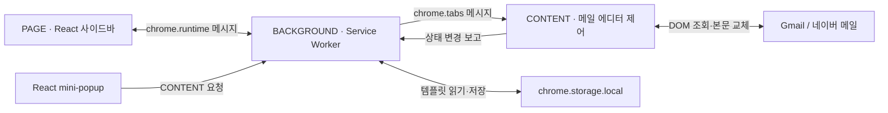
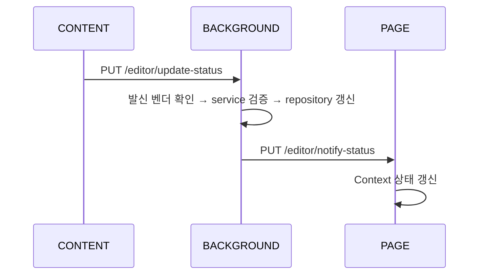

# Snip Text 동작 구조

이 문서는 현재 저장소의 구현을 기준으로 확장 프로그램의 실행 영역, 데이터 관리, 메시지 통신, 템플릿 삽입과 톤 교정 흐름을 설명합니다. `PAGE`, `BACKGROUND`, `CONTENT`는 Chrome 확장 프로그램 내부의 실행 영역을 구분하는 이름입니다.

## 1. 전체 구조

메일 페이지의 DOM에 접근할 수 있는 content script와 사이드바 화면은 서로 다른 환경에서 실행됩니다. background가 두 영역의 요청을 중계하고, 에디터 상태와 템플릿 데이터를 관리합니다.



mini-popup은 메일 페이지에 content script가 마운트하는 React UI입니다. 별도의 확장 프로그램 페이지로 실행되는 사이드바와 구분됩니다. background는 HTTP 서버가 아니라 Chrome 메시지를 처리하는 Service Worker입니다. `/template/list` 같은 경로도 실제 네트워크 주소가 아닌 내부 라우팅 식별자입니다.

| 영역 | 주요 진입점 | 담당 역할 |
| --- | --- | --- |
| background | `src/background/service-worker.ts` | 요청 분기, 발신자 검증, 서비스 호출, 데이터 관리, 삽입 중계 |
| content | `src/content/gmail.ts`, `src/content/naver.ts` | 에디터 탐색, 상태 감지, mini-popup 시작, 본문 DOM 변경 |
| sidebar | `packages/sidebar/src/main.tsx`, `App.tsx` | 템플릿 검색·복사·삽입, 변수 입력, 톤 교정 화면 |
| mini-popup | `packages/mini-popup/src/index.ts` | `/` 명령 감지, 목록·변수 폼·문체 선택 표시 |

## 2. 초기 실행

### 2.1 확장 프로그램 등록

`public/manifest.json`은 Manifest V3 설정입니다.

- background는 `src/background/service-worker.js`로 실행됩니다.
- Gmail은 `https://mail.google.com/*`에서 `gmail.js`를 실행합니다.
- 네이버 메일은 `https://mail.naver.com/*`에서 `naver.js`를 실행합니다. `all_frames`와 `match_origin_as_fallback`을 사용해 하위 프레임도 실행 대상으로 등록합니다.
- 두 content script는 `document_idle`에 실행됩니다.
- 사이드바의 진입 경로는 `src/page/index.html`입니다.
- 확장 프로그램 아이콘을 클릭하면 background가 클릭한 탭의 사이드바를 엽니다.

manifest의 프레임 주입 조건과 background의 메시지 발신자 허용 조건은 별개입니다. 스크립트가 실행되더라도 발신자 검증을 통과해야 요청이 처리됩니다.

### 2.2 Gmail

`gmail.ts`는 렌더링 이후 벤더 설정의 에디터 선택자로 `COMBINED` observer를 시작합니다. observer가 만들어지면 mini-popup을 시작하고 background의 삽입 요청을 받을 content 라우터를 등록합니다.

### 2.3 네이버 메일

`naver.ts`는 최상위 문서와 하위 프레임을 나누어 처리합니다.

1. 최상위 문서에서는 초기 URL이 작성 경로일 때 URL observer를 시작합니다.
2. URL observer는 약 100ms마다 주소 변화를 확인하고 작성 경로 여부를 `isEditable`로 보고합니다.
3. 실제 에디터 observer는 에디터 선택자가 존재하는 하위 프레임에서 시작합니다.
4. 해당 프레임에서 mini-popup과 content 삽입 라우터를 등록합니다.

작성 경로는 `/v2/new` 또는 그 하위 경로입니다. 최상위 문서의 URL 상태와 하위 프레임의 DOM 상태는 같은 벤더의 에디터 상태로 보고됩니다.

## 3. 메시지 통신과 권한

### 3.1 요청·응답 형식

공통 계약은 `src/core/message-types.ts`에 있습니다. workspace 패키지는 자체 메시지 타입과 래퍼도 가지고 있습니다.

```ts
const request = {
  src: "PAGE",
  dst: "BACKGROUND",
  method: "GET",
  path: "/template/list",
  data: {},
};

const response = {
  statusCode: 200,
  data: { templates: [] },
};
```

`src`와 `dst`는 실행 영역, `method`와 `path`는 동작, `data`는 입력값을 나타냅니다. `src` 문자열만으로 권한을 인정하지 않고 Chrome이 제공한 `sender`도 검사합니다.

`src/common/message-bus.ts`의 주요 역할은 다음과 같습니다.

- `sendMessage`: `chrome.runtime.sendMessage`로 확장 프로그램 내부 요청을 보냅니다.
- `sendToActiveTab`: 현재 창의 활성 탭을 찾고 `chrome.tabs.sendMessage`로 content에 요청합니다.
- `listenMessage`: 비동기 처리가 끝난 뒤 `sendResponse`로 응답합니다. 처리 중 예외는 일반적인 500 응답으로 변환합니다.

발신자 불일치나 담당하지 않는 요청은 응답 없이 반환할 수 있습니다. 호출부는 응답이 없거나 200이 아닌 경우도 처리해야 합니다.

### 3.2 background 라우팅

Service Worker는 `dst === "BACKGROUND"`인 요청을 경로 접두사로 분기합니다.

| 접두사 | 라우터 | 역할 |
| --- | --- | --- |
| `/auth/` | `background/auth/router.ts` | 토큰 CRUD |
| `/template/` | `background/template/router.ts` | 템플릿 조회·교체 |
| `/editor/` | `background/editor/router/router.ts` | 상태 조회·갱신·본문 삽입 |
| `/ai/` | `background/ai/router.ts` | 톤 교정 요청 |

어느 접두사에도 해당하지 않으면 404를 반환합니다. 각 라우터 안에서 지원하지 않는 경로·메서드는 응답 없이 끝날 수도 있습니다.

### 3.3 발신자 검사

`src/background/common/message-sender.ts`가 검증을 담당합니다.

PAGE 요청은 `src === "PAGE"`, 현재 확장 프로그램 ID, `sender.tab` 부재, 정확한 `chrome.runtime.getURL("src/page/index.html")` 주소가 모두 일치해야 합니다.

CONTENT 요청은 현재 확장 프로그램 ID, 유효한 탭 ID와 프레임 ID, 등록된 HTTPS 메일 호스트를 검사합니다. `sender.origin`이 있으면 URL의 origin과 같아야 합니다. 예외적으로 `frameId > 0`인 `about:blank` 프레임은 허용된 메일 origin을 상속한 경우 통과합니다. 현재 구현은 `about:srcdoc`, `blob:`, `data:`, `filesystem:`을 허용하지 않습니다.

| 요청 | PAGE | CONTENT |
| --- | --- | --- |
| 템플릿 목록 | 허용 | 허용 |
| 템플릿 전체 교체 | 허용 | 불허 |
| 인증 토큰 CRUD | 허용 | 불허 |
| 에디터 본문 조회·삽입 | 허용 | 허용 |
| 에디터 전체 상태 조회 | 허용 | 불허 |
| 에디터 상태 보고 | 불허 | 허용 |
| 톤 교정 | 허용 | 허용 |

## 4. 에디터 상태 관리

### 4.1 데이터 구조와 저장 범위

```ts
interface EditorStatus {
  isEditable: boolean;
  text: string;
  prevTexts: string[];
  vendorName: "GOOGLE" | "NAVER";
}
```

`background/editor/repository.ts`는 벤더별 `snip.GOOGLE`, `snip.NAVER` 키에 상태를 메모리로 보관합니다. 초기값은 편집 불가, 빈 본문, 빈 이전 본문 목록입니다.

이 상태는 탭별·프레임별 저장이 아닙니다. 같은 벤더의 여러 탭이나 작성 창이 상태를 보고하면 하나의 벤더 상태를 공유합니다. Service Worker가 종료되면 상태도 사라집니다. `background/common/storage.ts`에 session storage 래퍼가 있지만 에디터 repository는 이 래퍼를 사용하지 않습니다.

### 4.2 변경 감지

현재 두 벤더가 사용하는 `EditorCombinedObserver`는 다음 입력을 함께 감지합니다.

- `focusin`: 사용자가 선택한 에디터를 확인합니다.
- `input`: 본문 입력 변화를 확인합니다.
- `MutationObserver`: 에디터 생성·삭제, 텍스트와 속성 변경을 확인합니다.

포커스된 요소 또는 그 조상에서 에디터를 우선 찾고, 없으면 화면에 보이는 첫 에디터를 선택합니다. 에디터나 본문이 달라졌을 때 callback을 예약하며, 같은 이벤트 루프의 여러 변경은 `queueMicrotask`로 합칩니다.

대체 구현으로 DOM 변경만 감지하는 `EditorMutationObserver`와 250ms마다 확인하는 `EditorPollingObserver`가 있습니다. `COMBINED` 자체는 폴링을 사용하지 않습니다.

### 4.3 상태 전달



content는 `{ vendorName, status: { isEditable, text } }`를 보냅니다. background는 실제 발신 URL의 벤더와 요청 벤더가 같은지 확인합니다. service는 필드별 타입을 확인하고 알 수 없는 필드나 서로 다른 `vendorName`을 거부합니다.

사이드바의 `useMessageListener`는 알림 리스너를 먼저 등록한 뒤 활성 탭의 벤더에 대해 `GET /editor/status`를 요청합니다. 초기 조회가 늦게 도착해도 이미 받은 실시간 알림을 덮어쓰지 않습니다. 상태는 벤더별 `statuses`와 가장 최근 수신 상태인 `latestStatus`로 관리하고, 수신 시각과 갱신 횟수를 함께 기록합니다. 언마운트 시 리스너를 제거합니다.

## 5. 템플릿 데이터 관리

### 5.1 스키마와 목록 조회

```ts
interface Template {
  templateId: number;
  title: string;
  shortcut: string;
  content: string;
  variables: string[];
  lastUsedAt: string;
  createdAt: string;
  editedAt: string;
}
```

`GET /template/list`는 `200 { templates }`를 반환합니다. repository는 `chrome.storage.local`의 `snip.templates`를 읽고, 저장값이 없으면 코드의 기본 템플릿을 반환합니다. 기본 목록을 조회하는 것만으로 저장소에 기록하지는 않습니다.

과거 데이터의 `id`, `name`, `command`, `text`는 현재 필드로 변환합니다. 유효하지 않은 ID에는 사용 중인 ID를 피해서 양의 정수를 부여하고, 변수 목록이 없으면 본문에서 추출합니다. 날짜 정보가 없으면 `1970-01-01T00:00:00.000Z`를 기준으로 보완합니다. 이 변환은 조회 결과를 만드는 과정이며 조회만으로 원본을 다시 저장하지 않습니다.

목록은 repository가 반환한 순서를 유지합니다. 현재 구현에는 최근 사용 순 정렬이나 사용 시각 갱신 경로가 없습니다.

### 5.2 템플릿 전체 교체

PAGE의 `PUT /template/replace`는 위 스키마의 모든 필드를 받아 기존 템플릿 하나를 전체 교체합니다. 일부 필드만 병합하는 PATCH 동작이 아닙니다.

service의 검증 조건은 다음과 같습니다.

- ID는 안전한 양의 정수여야 합니다.
- 정의되지 않은 필드는 허용하지 않습니다.
- 이름·단축어·본문은 공백만으로 구성할 수 없습니다.
- 이름과 단축어는 양끝 공백을 제거하고, 본문은 원문을 유지합니다.
- 단축어는 `/`로 시작하며 뒤에 공백이나 추가 `/`가 없어야 합니다.
- 변수는 양끝 공백이 없는 중복 없는 문자열 배열이어야 하고 본문의 변수 집합과 같아야 합니다.
- 날짜 세 필드는 시간대가 포함된 ISO 8601 형식이며 파싱 가능한 값이어야 합니다.
- 다른 템플릿과 단축어가 중복되면 거부합니다.

repository는 Promise 대기열로 읽기·수정·저장을 직렬화해 동시에 들어온 교체 요청이 서로의 변경을 덮어쓰는 문제를 줄입니다. 성공은 `200 { template }`, 없는 ID는 404, 입력 오류는 400, 저장 등 처리 실패는 500입니다.

## 6. 본문 삽입

### 6.1 요청 대상을 선택하는 방법

두 UI는 모두 `PUT /editor/insert-text`와 `{ text }`를 사용하지만 background의 전달 대상이 다릅니다.

| 요청 시작점 | 전달 대상 |
| --- | --- |
| 사이드바 PAGE | 현재 창의 활성 탭 |
| mini-popup CONTENT | 요청을 보낸 탭과 동일한 프레임 |

CONTENT 요청은 `sender.tab.id`와 `sender.frameId`로 전달 대상을 지정합니다. PAGE 요청은 `sendToActiveTab`을 사용하며 프레임 ID를 지정하지 않습니다.

### 6.2 실제 DOM 변경

1. background는 비어 있지 않은 문자열인지 확인합니다.
2. `BACKGROUND → CONTENT` 삽입 메시지를 보냅니다.
3. content 라우터는 문자열을 정규화하고 미치환 `{{...}}`가 남아 있으면 400으로 거부합니다.
4. observer가 추적하는 에디터를 가져옵니다.
5. `insertTextToEditor`가 기존 `textContent`를 이전 본문으로 보관하고 에디터 내용을 비웁니다.
6. 새 본문을 텍스트 노드와 `<br>`로 구성하고 커서를 끝에 둡니다.
7. content가 `prevText`, `text`, `isInserted`, `vendorName`을 반환합니다.
8. background는 반환된 본문과 이전 본문을 저장한 뒤 PAGE에 상태를 알립니다.

현재 삽입은 **에디터 본문 전체 교체**입니다. mini-popup이 `/검색어`의 Range를 보관하는 목적은 트리거와 작성 창의 유효성 검사입니다. 실제 삽입 함수는 해당 Range만 치환하지 않습니다.

이전 본문은 비어 있지 않을 때 `prevTexts` 앞에 추가합니다. 일반적인 삽입 이력 추가 경로는 최대 두 항목을 유지합니다. 이력 저장과 별개로 사용자용 되돌리기 API나 UI는 현재 연결되어 있지 않습니다.

### 6.3 텍스트 정규화와 공백 처리

`src/content/utils/editor-text.ts`가 공통 처리를 담당합니다.

- `normalizeEditorText`: U+200B를 제거하고 Unicode NFC로 정규화합니다. 다른 공백과 이모지 결합 문자는 유지합니다.
- `encodeEditorText`: CRLF를 LF로 바꾸고 줄 양끝 공백과 연속된 일반 공백을 NBSP로 변환해 HTML 에디터에서 공백이 접히는 것을 줄입니다.

삽입은 `innerHTML` 대신 텍스트 노드를 사용하므로 HTML 형태의 입력도 문자로 삽입합니다. Range 처리가 실패하면 같은 인코딩을 적용한 `textContent` 대입으로 대체합니다. 이 대체 경로는 `<br>`를 만들지 않습니다. 현재 함수는 별도의 `input` 이벤트를 발생시키지 않으므로 메일 서비스의 입력 인식과 실행 취소 동작은 실제 브라우저에서 확인해야 합니다.

## 7. mini-popup

### 7.1 패키지와 상태 분리

`@snip-text/mini-popup`은 메일 문서에 호스트와 React root를 생성합니다. `startPopup`은 이를 제거하는 정리 함수를 반환합니다.

| 파일·영역 | 역할 |
| --- | --- |
| `index.ts` | 호스트·React root 생성, 연결 옵션 선택 |
| `actions.ts` | 템플릿·본문 조회, 삽입, 톤 교정 메시지 연결 |
| `hooks/useMiniPopup.ts` | 화면 상태, 요청 경합, 선택·삽입 흐름 |
| `hooks/usePopupPosition.ts` | 렌더링과 viewport 변경에 따른 위치 갱신 |
| `dom/index.ts`와 하위 모듈 | 에디터 Range, 포커스, 이벤트, 위치, 호스트 접근 |
| `components/` | 목록, 변수 입력, 문체 메뉴, 로딩 화면 |
| `utils/text.ts` | 변수 추출·치환 |

소비자는 조회·삽입 함수를 직접 주입하거나 `vendorName`, `getEditorStatus`를 넘겨 기본 Chrome 메시지 연결을 사용할 수 있습니다. 현재 content 진입점은 후자의 방식을 사용합니다.

### 7.2 트리거와 검색

에디터 어댑터는 선택 영역과 커서 앞 텍스트를 읽어 `/검색어`를 찾습니다. 일반 명령은 본문 시작 또는 공백 다음에서 시작해야 하고 검색어에 공백이나 추가 `/`를 포함하지 않습니다. `/톤`, `/톤교`, `/톤교정` 계열은 별도 명령으로 인식합니다.

트리거를 찾으면 에디터, Range, 트리거 원문을 보관합니다. 삽입 전에 에디터가 문서에 연결되어 있고 Range가 같은 트리거를 가리키는지 확인합니다. 메일 페이지가 DOM을 다시 만들면 재입력을 안내합니다.

일반 검색은 background에서 목록을 가져와 제목·단축어·본문의 NFC 정규화 및 소문자 검색으로 필터링합니다. 톤 교정 접두사를 입력하면 전용 명령을 먼저 표시합니다.

### 7.3 화면 상태와 비동기 처리

화면은 `closed`, `loading`, `error`, `list`, `variables`, `tones` 상태로 관리합니다. 삽입·교정 중에는 `busy`로 중복 동작을 막습니다.

각 비동기 요청에는 증가하는 `requestId`를 사용합니다. 검색 변경, 팝업 닫기, 언마운트 이후 도착한 과거 응답은 반영하지 않습니다. 한글 조합 시작·종료도 추적해 조합 중 Enter나 방향키가 선택 동작으로 잘못 처리되는 것을 방지합니다.

목록의 ↑↓는 항목을 순환하고 Enter는 항목을 선택합니다. 변수 입력의 Tab 이동과 일반 입력은 브라우저 동작을 사용합니다. 변수 폼의 Esc·취소는 목록으로 돌아갑니다. 목록의 Esc는 기본 동작을 막지만 현재 목록 연결 코드에는 닫기 호출이 없습니다. 바깥 클릭은 팝업을 닫습니다. 이벤트 전파를 일괄 차단하지 않습니다.

### 7.4 변수 입력

같은 변수명은 한 번만 입력받습니다. 입력값은 미리보기 계산에 즉시 반영합니다. **현재 치환 함수는 비어 있거나 공백뿐인 값에 원래 `{{변수}}`를 남깁니다.** 미치환 변수가 남은 본문은 content 라우터에서 거부됩니다.

변수가 없는 템플릿은 즉시 삽입을 요청합니다. 변수가 있으면 입력 화면으로 이동하고 사용자가 삽입을 선택한 뒤 요청합니다. 실패하면 오류를 표시하고 입력 상태를 유지합니다.

## 8. 사이드바

`App.tsx`는 `EditorStatusProvider` 아래에서 템플릿 목록과 톤 교정 화면을 전환합니다. 현재 로그인 화면 분기는 주석 처리되어 있고, 목록 화면에는 에디터 상태 확인 패널도 표시됩니다. 로그아웃 버튼에는 실제 처리 함수가 연결되어 있지 않습니다.

### 8.1 템플릿 조회·검색·복사

`TemplateListPage`는 마운트 시 목록을 조회합니다. `chrome.storage.onChanged`에서 local 저장소 변경을 받으면 다시 조회합니다. 요청 세대 번호와 마운트 여부를 검사해 오래된 성공 응답이 최신 목록을 덮어쓰지 않도록 합니다.

검색은 제목·본문·단축어를 합쳐 대소문자를 구분하지 않는 부분 일치로 처리합니다. 목록 순서는 응답 순서입니다. 복사는 원본 `content`를 클립보드에 기록하므로 변수도 그대로 복사됩니다.

새 템플릿 버튼은 `packages/sidebar/src/config.ts`의 `newTemplateUrl`을 사용합니다. 빈 값이면 비활성화하고, 설정값이 HTTP(S) URL인지 확인한 후 현재 사이드바 페이지를 이동시킵니다. AI 톤교정 버튼은 내부 화면을 전환합니다.

### 8.2 변수와 삽입

본문에 변수가 있으면 `TemplateInsertPage`에서 중복 없는 입력 필드와 미리보기를 표시합니다. 비어 있는 값은 원래 placeholder를 유지합니다. 닫기·Esc는 삽입 없이 목록으로 돌아갑니다.

`InsertBodyButton`은 중복 요청 방지, 메시지 전송, 성공·실패 알림을 공통 처리합니다. 템플릿 삽입 버튼의 편집 가능 여부는 수신한 벤더별 상태 중 하나라도 `isEditable`이면 참으로 판단합니다. 실제 삽입 대상은 요청 시 활성 탭이므로 이 UI 상태가 특정 탭의 삽입 성공을 보장하지는 않습니다.

## 9. 톤 교정

### 9.1 공통 background 처리

`POST /ai/tone-correction`은 PAGE와 CONTENT에서 호출할 수 있습니다.

- PAGE는 `{ vendorName, tone }`을 보냅니다.
- CONTENT는 `{ tone }`을 보내며 벤더는 실제 발신자 정보로 결정합니다.
- service는 비어 있지 않은 문체와 지원 벤더를 검증합니다.
- 본문은 요청 데이터에서 받지 않고 background의 에디터 상태에서 읽습니다.
- CONTENT 요청은 본문 끝의 `/톤`, `/톤교`, `/톤교정` 명령과 뒤 공백을 제거합니다.
- 교정 대상 본문이 비어 있으면 400을 반환합니다.

**현재 교정 결과는 `(톤교정)` 접두사를 원문 앞에 붙인 임시 문자열입니다.** 선택 문체에 따른 실제 변환, 외부 AI API 호출, Qwen 모델 실행은 현재 코드에 없습니다. 결과는 `200 { text }`로 반환하며 이 API 자체는 에디터를 변경하지 않습니다.

### 9.2 mini-popup 경로

1. 사용자가 톤 교정 명령과 문체를 선택합니다.
2. background에서 원본 본문을 조회합니다.
3. 연결 액션이 현재 observer의 본문·편집 상태를 background에 동기화합니다.
4. 교정 API를 호출합니다.
5. background 본문을 다시 조회하고 최초 본문과 비교합니다.
6. 본문이 달라졌거나 트리거가 유효하지 않으면 삽입을 중단합니다.
7. 유효하면 공통 삽입 API로 결과를 본문 전체에 반영합니다.

### 9.3 사이드바 경로

사이드바는 `latestStatus`의 본문을 읽기 전용 textarea로 표시합니다. 문체를 고르면 교정 요청을 보내고, 성공 결과를 공통 삽입 API로 전달합니다. 요청과 삽입 중에는 중복 실행을 막고 진행 상태를 표시합니다.

현재 사이드바 경로에는 mini-popup과 같은 교정 전후 본문 비교가 없습니다. `(0/10)` 표시는 고정 UI 문구이며 실제 사용량 집계·제한 로직과 연결되어 있지 않습니다. 두 UI의 문체 선택 목록도 각각 정의되어 있습니다.

## 10. 인증 토큰

`background/auth`는 OAuth 로그인이나 프로필 조회를 수행하지 않고 PAGE에 토큰 CRUD만 제공합니다. vendor 값은 현재 벤더 ID인 `GOOGLE`, `NAVER`입니다.

| 메서드 | 경로 | 입력 | 처리 |
| --- | --- | --- | --- |
| POST | `/auth/token` | `{ vendor, token, expiresAt? }` | 생성, 이미 있으면 400 |
| GET | `/auth/token` | `{ vendor }` | 복호화한 토큰 조회, 없으면 404 |
| PUT | `/auth/token` | `{ vendor, token, expiresAt? }` | 기존 토큰 교체, 없으면 404 |
| DELETE | `/auth/token` | `{ vendor }` | 삭제 여부 `{ deleted }` 반환 |

만료 시각은 epoch 밀리초입니다. 생략하면 5분이고, 입력해도 현재부터 최대 5분으로 제한됩니다. token은 비어 있지 않은 문자열이어야 합니다.

repository는 암호문, 만료 시각, 삭제 타이머를 메모리 Map에 보관합니다. 타이머로 제거하고 조회 시에도 만료를 다시 검사합니다. 복호화 실패 시 해당 토큰을 삭제합니다. 워커 종료 후 복원하거나 자동 갱신하지 않습니다.

`token-crypto.ts`는 AES-256-GCM과 매 암호화마다 생성하는 12바이트 IV를 사용합니다. vendor와 만료 시각은 추가 인증 데이터로 묶습니다. webpack은 빌드마다 32바이트 난수 키를 생성해 번들 상수로 주입합니다. 이 키는 배포 번들에서 확인할 수 있으므로 사용자에게 숨겨진 서버 비밀키로 취급할 수 없습니다. CRUD 응답에는 평문 토큰이 포함될 수 있으며 content에 전달하지 않습니다.

## 11. 벤더 설정과 빌드

`src/config/vendors.json`은 벤더 ID, 표시명, 메일 호스트, 작성 경로, 에디터 선택자, 스크립트 이름을 관리합니다. `vendors.ts`는 이 정의를 기반으로 타입 검사, 정확한 HTTPS 호스트 판별, 작성 경로 판별을 제공합니다.

sidebar는 `packages/sidebar/src/config/vendors.ts`에서 자체 벤더 정의를 관리합니다. 다른 workspace의 소스를 직접 import하지 않으므로 벤더 추가 시 양쪽의 ID를 일치시켜야 합니다. manifest의 실행 도메인·프레임 조건과 webpack의 content 진입점도 함께 등록해야 합니다.

전체 빌드는 다음 순서입니다.

1. `npm run build:popup`: mini-popup ESM 번들과 타입 선언 생성.
2. `tsc`: 루트 TypeScript 검사.
3. webpack: background·content 번들 생성, manifest 복사, 인증 키 주입.
4. `npm run build:sidebar`: sidebar를 빌드하고 결과를 `dist/src/page/`로 복사.

`npm run dev`는 sidebar 개발 서버입니다. 확장 프로그램의 background·content 전체를 Chrome에 설치하는 과정은 별도로 필요합니다.

## 12. 구현 확인 시 주의할 경계

다음 항목은 현재 코드의 동작과 미완성 부분을 구분하기 위한 기준입니다.

- 템플릿은 local 저장소에 남지만 에디터 상태와 토큰은 워커 메모리에만 있습니다.
- 에디터 상태는 벤더별이며 탭별·프레임별로 분리되어 있지 않습니다.
- 삽입은 본문 전체를 교체하며 `/검색어`만 교체하지 않습니다.
- 빈 변수값은 placeholder를 유지하고, 남은 placeholder는 삽입 단계에서 거부됩니다.
- 템플릿 생성·삭제 및 `/template/use` 경로는 현재 라우터에 없습니다. 복사·삽입 시 `lastUsedAt`을 자동 갱신하지 않습니다.
- 실제 AI 교정, OAuth 로그인, 로그아웃, 사용량 제한은 연결되어 있지 않습니다.
- `about:srcdoc` 허용, 빈 변수의 빈 문자열 치환 등 README의 일부 설명은 현재 구현과 차이가 있습니다. 동작 판단 시 해당 소스와 테스트를 함께 확인해야 합니다.

## 13. 검증 위치

| 테스트 파일 | 주요 확인 대상 |
| --- | --- |
| `tests/message-sender.test.mjs` | 발신자 검증과 요청 권한 |
| `tests/vendors.test.mjs` | 벤더·도메인·작성 경로·빌드 등록 |
| `tests/template.test.mjs` | 템플릿 검증과 저장 |
| `tests/editor-service.test.mjs` | 에디터 상태 입력 검증 |
| `tests/insert-text.test.mjs` | 본문 교체와 공백·개행 처리 |
| `tests/mini-popup.test.mjs` | 팝업 선택·입력·비동기 처리 |
| `tests/mini-popup-dom.test.mjs` | 팝업 DOM 어댑터 |
| `tests/naver.test.mjs` | 네이버 메일 연결 |
| `tests/ai.test.mjs` | 톤 교정 service·router |
| `tests/sidebar-tone.test.mjs` | 사이드바 톤 교정 흐름 |
| `tests/auth.test.mjs` | 토큰 검증·암호화·만료 |

테스트는 필요한 파일을 골라 `node --test tests/<파일명>.test.mjs`로 실행합니다. DOM 기반 테스트는 실제 Gmail·네이버 메일의 렌더링, 프레임 전달, 입력 인식과 실행 취소까지 보장하지 않으므로 해당 동작은 Chrome에서 별도로 확인해야 합니다.
